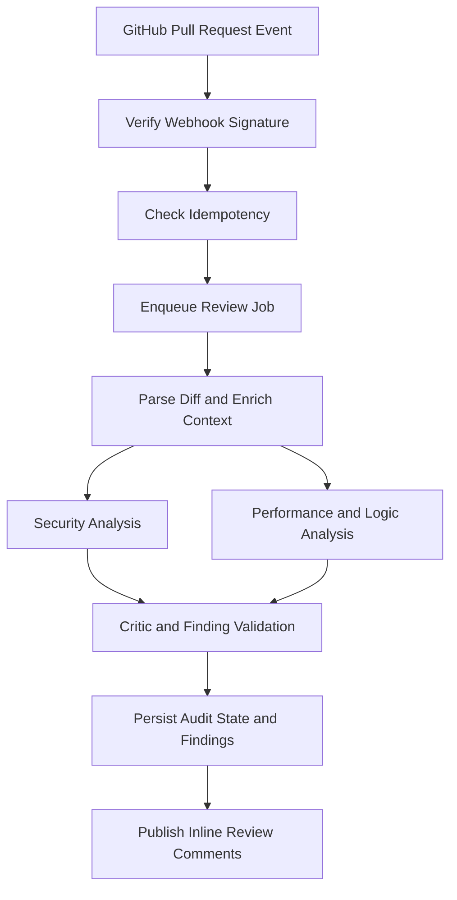

<div align="center">

# हेतुः HetuPR

### **Every Finding Has a Reason.**

An open-source, context-aware AI code reviewer and security auditor for GitHub Pull Requests, inspired by *Hetu* (हेतु), the reason or ground that supports a conclusion in Indian logic.

[](LICENSE)
[](https://github.com/<your-username>/hetupr/actions)
[](CONTRIBUTING.md)
[](CODE_OF_CONDUCT.md)

[](https://www.python.org/)
[](https://fastapi.tiangolo.com/)
[](https://langchain-ai.github.io/langgraph/)
[](https://www.postgresql.org/)
[](https://redis.io/)
[](https://www.docker.com/)

**Review with context. Flag with evidence. Merge with confidence.**

</div>

---

## Table of Contents

- [About](#about)
- [Features](#features)
- [How It Works](#how-it-works)
- [Architecture](#architecture)
- [Tech Stack](#tech-stack)
- [Project Structure](#project-structure)
- [Getting Started](#getting-started)
- [GitHub App Setup](#github-app-setup)
- [Configuration](#configuration)
- [Testing and Linting](#testing-and-linting)
- [Security](#security)
- [Observability](#observability)
- [Roadmap](#roadmap)
- [Contributing](#contributing)
- [Code of Conduct](#code-of-conduct)
- [License](#license)
- [Acknowledgements](#acknowledgements)
- [Disclaimer](#disclaimer)

---

## About

Good code review explains **what the risk is, where it appears, and why it matters**, not just "this looks wrong."

HetuPR is an event-driven GitHub App that reviews Pull Requests using multi-step, context-aware analysis. It parses the diff, enriches changed lines with surrounding code, runs specialized security and performance analysis, and passes every candidate finding through a **critic stage** that validates it before it becomes a review comment.

The name comes from **Hetu (हेतु)**, a concept in Indian logical traditions meaning the reason or inferential ground behind a conclusion. That is the product idea: every finding should come with its reasoning.

## Features

**Security analysis**
- SQL injection and unsafe query construction
- Hardcoded secrets and credential exposure
- Server-side request forgery (SSRF) patterns
- Weak or incorrect JWT validation
- Unsafe deserialization

**Performance and concurrency**
- Blocking I/O inside async functions
- N+1 database query patterns
- Missing or ineffective indexes (where evidence is available)
- Transaction and rollback handling
- Race conditions and database-lock risks

**Review quality**
- Diff-aware findings mapped to valid changed lines
- Context enrichment from surrounding functions (AST-based)
- Duplicate finding suppression
- Critic stage to reduce false positives
- Inline GitHub Pull Request review comments

**Platform**
- HMAC-verified webhooks with idempotent processing
- Redis-backed async job queue
- PostgreSQL audit trail of reviews and findings
- Prometheus metrics and Grafana dashboards
- Angular dashboard for configuration and analytics

> Detection depends on the code, available context, model behavior, and implementation. HetuPR assists reviewers; it does not replace them.

## How It Works



1. **Receive**: accept a GitHub webhook and verify its HMAC-SHA256 signature.
2. **Deduplicate**: skip deliveries that were already processed.
3. **Queue**: hand work to Redis-backed workers so webhook handling stays fast.
4. **Enrich**: parse the unified diff and gather surrounding code context.
5. **Analyze**: run specialized security and performance/logic nodes.
6. **Critique**: validate findings against changed lines; drop weak or duplicate results.
7. **Report**: persist audit metadata and post line-level comments via the GitHub API.

## Architecture

```text
GitHub PR Webhook
      │  HMAC-SHA256 verification
      ▼
Nginx (TLS / rate limits) ──▶ FastAPI Webhook API (validate + enqueue)
                                   │
                    ┌──────────────┴──────────────┐
                    ▼                             ▼
           Redis (queue, cache,          PostgreSQL (audit state,
           idempotency)                  findings)
                    │
                    ▼
           Async Workers (LangGraph)
                    │
                    ▼
           Context + AST / Diff Processing
                    │
                    ▼
           Security + Performance / Logic Analysis
                    │
                    ▼
           Critic / Finding Validation
                    │
                    ▼
           GitHub Review API (inline comments)
```

| Component | Responsibility |
|---|---|
| **FastAPI** | Webhook intake and REST endpoints |
| **Redis** | Queueing, idempotency, caching, rate limiting |
| **Async workers** | Run background review jobs |
| **LangGraph** | Coordinate stateful analysis stages |
| **PostgreSQL** | Installations, audit records, findings, workflow state |
| **GitHub API** | Fetch PR context and publish review comments |
| **Prometheus + Grafana** | Metrics and dashboards |
| **Nginx** | Reverse proxy and edge controls |

## Tech Stack

| Layer | Technology |
|---|---|
| Runtime | Python 3.12+ |
| API | FastAPI, Uvicorn |
| Agent workflow | LangGraph, LangChain, OpenAI API |
| Code context | Diff parsing, AST processing |
| Database | PostgreSQL 16, SQLAlchemy 2.0, asyncpg, Alembic |
| Queue / cache | Redis 7 (`redis.asyncio`) |
| Frontend | Angular, TypeScript |
| Infrastructure | Docker Compose, Nginx |
| CI/CD | GitHub Actions |
| Observability | Prometheus, Grafana, Structlog |
| Testing | Pytest, Locust, Ruff |

## Project Structure

```text
hetupr/
├── .github/
│   ├── workflows/            # ci.yml, cd.yml
│   ├── ISSUE_TEMPLATE/
│   └── PULL_REQUEST_TEMPLATE.md
├── backend/
│   ├── app/
│   │   ├── api/v1/           # webhooks.py, repos.py, metrics.py
│   │   ├── agent/            # graph.py, nodes/, schemas.py
│   │   ├── core/             # config, security, logging, ratelimit
│   │   ├── db/               # session.py, models.py
│   │   ├── workers/          # consumer.py
│   │   └── main.py
│   ├── tests/
│   ├── alembic/
│   ├── Dockerfile
│   └── pyproject.toml
├── frontend/                 # Angular dashboard
├── infra/                    # nginx, prometheus, docker-compose
├── .env.example
├── CODE_OF_CONDUCT.md
├── CONTRIBUTING.md
├── LICENSE
├── SECURITY.md
└── README.md
```

## Getting Started

### Prerequisites

- Docker and Docker Compose
- Python 3.12+ (for local development)
- Git
- An [OpenAI API key](https://platform.openai.com/)
- A [GitHub App](#github-app-setup) for your repositories

### 1. Clone

```bash
git clone https://github.com/<your-username>/hetupr.git
cd hetupr
```

### 2. Configure environment

```bash
cp .env.example .env
```

Edit `.env` with your values (see [Configuration](#configuration)). **Never commit `.env` or any private key.**

### 3. Start the services

```bash
docker compose -f infra/docker-compose.prod.yml up --build -d
```

For local development, use a dev-specific Compose file if one is provided.

### 4. Run database migrations

```bash
docker compose exec backend alembic upgrade head
```

### 5. Open the local endpoints

| Service | URL |
|---|---|
| API docs (Swagger UI) | http://localhost:8000/docs |
| Angular dashboard | http://localhost:4200 |
| Grafana | http://localhost:3000 |
| Prometheus metrics | http://localhost:8000/api/v1/metrics |

## GitHub App Setup

1. Go to **GitHub → Settings → Developer settings → GitHub Apps → New GitHub App**.
2. Set the **Webhook URL** to your public HTTPS endpoint (e.g. `https://your-domain.com/api/v1/webhooks/github`).
3. Set a long random **Webhook secret** and use the same value for `GITHUB_WEBHOOK_SECRET`.
4. Grant least-privilege **repository permissions**:
   - Contents: Read
   - Pull requests: Read & write
   - Metadata: Read
5. Subscribe to the **Pull request** event.
6. Generate a **private key**, download the `.pem`, and point `GITHUB_PRIVATE_KEY_PATH` at it.
7. Install the app on the repositories you want reviewed.

For local development, use a webhook forwarder such as [smee.io](https://smee.io/) or `ngrok`. Do not expose an unauthenticated dev server to the public internet.

## Configuration

| Variable | Description | Example |
|---|---|---|
| `ENV` | Runtime environment | `development` |
| `LOG_LEVEL` | Log verbosity | `INFO` |
| `DATABASE_URL` | Async PostgreSQL URL | `postgresql+asyncpg://postgres:postgres@db:5432/hetupr` |
| `REDIS_URL` | Redis URL | `redis://redis:6379/0` |
| `GITHUB_APP_ID` | Your GitHub App ID | `123456` |
| `GITHUB_WEBHOOK_SECRET` | Webhook HMAC secret | long random string |
| `GITHUB_PRIVATE_KEY_PATH` | Path to the GitHub App private key | `./certs/github-private-key.pem` |
| `OPENAI_API_KEY` | OpenAI API key | `sk-...` |

Keep variable names in sync with `backend/app/core/config.py` and `.env.example`.

## Testing and Linting

```bash
# Tests
pytest backend/tests/ -v

# Lint
ruff check backend/

# Load test (only against systems you own or are authorized to test)
locust -f backend/tests/locustfile.py --headless -u 50 -r 5 --run-time 2m --host http://localhost:8000
```

Quality gates we care about:
- Valid and invalid webhook signatures are tested
- Duplicate deliveries never create duplicate reviews
- Findings point to valid lines in the changed diff
- Low-confidence findings are withheld or clearly marked
- Secrets never appear in logs or stored payloads

## Security

- **Webhook authenticity**: `X-Hub-Signature-256` verified with HMAC-SHA256 and constant-time comparison.
- **Short-lived credentials**: GitHub App installation tokens, not long-lived PATs.
- **Secret hygiene**: keys and credentials stay out of source control.
- **Least privilege**: only the GitHub permissions the app needs.
- **Untrusted input**: repository contents and PR text are treated as untrusted and must not override agent instructions (prompt-injection awareness).
- **Safe logging**: no tokens, private keys, or sensitive source in logs.

Found a vulnerability? **Please do not open a public issue.** See [SECURITY.md](SECURITY.md) for responsible disclosure.

## Observability

Structured logs (Structlog) plus Prometheus/Grafana. Useful signals include webhook latency and failures, queue depth and retries, review duration, GitHub API errors, model latency and token usage, findings by category/severity, and rejected signatures. Use correlation IDs across webhook → queue → agent → review, and keep secrets out of metric labels.

## Roadmap

- [ ] Complete and verify local development setup docs
- [ ] Unit and integration tests for each agent node
- [ ] Replay-safe webhook processing and retry recovery
- [ ] Validate inline comment positions against GitHub diff semantics
- [ ] Configurable severity thresholds and per-repo rules
- [ ] Review summaries with evidence and remediation guidance
- [ ] Evaluation datasets for false-positive / false-negative tracking
- [ ] Cost controls, model timeouts, graceful degradation
- [ ] Support for additional LLM providers
- [ ] Deployment, backup, and rollback documentation

Have an idea? [Open a feature request](https://github.com/<your-username>/hetupr/issues/new).

## Contributing

Contributions of all kinds are welcome: bug reports, features, docs, tests, and evaluation datasets.

1. Read [CONTRIBUTING.md](CONTRIBUTING.md).
2. Open an issue for significant changes first.
3. Fork, create a focused branch, and add tests.
4. Run `pytest` and `ruff check` before pushing.
5. Open a Pull Request with context and verification steps.

Look for issues labeled `good first issue` and `help wanted`.

## Code of Conduct

This project follows the [Contributor Covenant](CODE_OF_CONDUCT.md). By participating, you agree to uphold it.

## License

Released under the [MIT License](LICENSE). Copyright (c) 2026 `<Your Name>`.

## Acknowledgements

- [FastAPI](https://fastapi.tiangolo.com/), [LangGraph](https://langchain-ai.github.io/langgraph/), [SQLAlchemy](https://www.sqlalchemy.org/), [Redis](https://redis.io/), [Prometheus](https://prometheus.io/), [Grafana](https://grafana.com/)
- The Indian logic tradition (Nyaya) for the idea of *Hetu*

## Disclaimer

HetuPR uses AI models, which can produce incorrect or incomplete findings. It is a review aid, not a security guarantee. Keep conventional tests, static analysis, and human review in your workflow. Any performance numbers should be re-measured in your own environment before being treated as commitments. The software is provided "as is" without warranty (see [LICENSE](LICENSE)). Source code sent to third-party LLM providers is subject to those providers' terms; review your data-handling requirements before enabling HetuPR on private repositories.

---

<div align="center">

### **HetuPR: Reason Before You Merge.**

If this project helps you, consider giving it a ⭐

</div>
